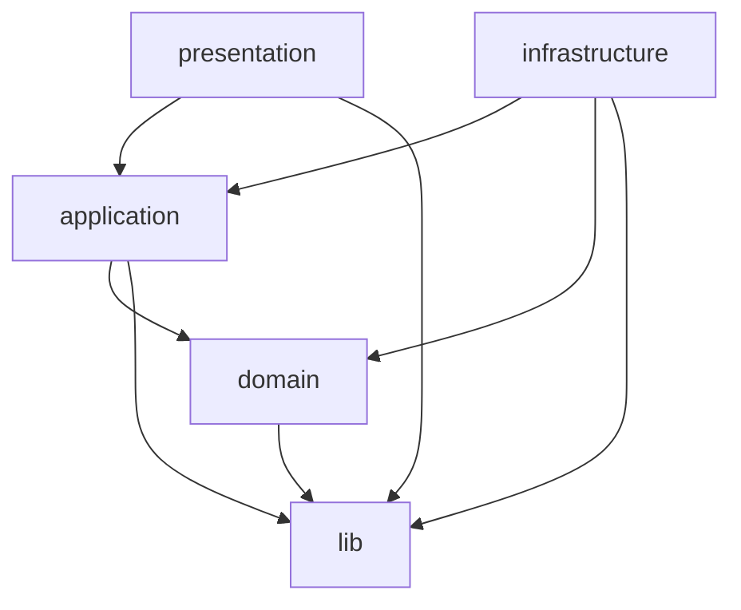

# 아키텍처

## 레이어
- 소스 코드는 `domain`, `application`, `infrastructure`, `presentation` 4개 레이어로 나눔
  - nocap의 변경은 대부분 바깥쪽에서 일어남. 예: 테스트 언어 추가, 실행 결과 입력, 출력 형식 추가, 명령 추가
  - 커버리지 판정 규칙은 거의 바뀌지 않음
  - 바뀌는 부분과 바뀌지 않는 부분을 나누면 입력 형식을 추가해도 판정 규칙을 고치지 않음
- `domain`은 커버리지 판정 규칙을 가짐
- `application`은 포트 interface를 정의함
- `application`은 유스케이스 흐름을 조립함
- `infrastructure`는 포트를 구현함
- `presentation`은 CLI와 출력 포매터를 가짐
- CLI 진입점 `src/bin.ts`와 라이브러리 진입점 `src/index.ts`는 레이어에 속하지 않음
  - 두 진입점은 실제 어댑터를 만들어 유스케이스에 넣는 조립만 함. 그래서 모든 레이어를 import함
- `src/lib`은 레이어에 속하지 않음. 도메인 개념이 아닌 일반 계산을 둠. 예: 비어 있지 않은 배열로 좁히는 `isNonEmpty`
  - 여러 레이어가 같은 일반 계산을 쓰면 `lib`에 하나만 둠. 파일마다 복사하면 한 곳만 고쳐져 동작이 갈라짐
  - 도메인 개념이 아닌 코드를 `domain`에 두면 `domain`이 판정 규칙만 가진다는 경계가 흐려짐

## 의존성 규칙
- 바깥 레이어는 안쪽 레이어를 import할 수 있음. 안쪽 레이어는 바깥 레이어를 import하지 않음
- `presentation`과 `infrastructure`는 같은 거리의 바깥 레이어임. 두 레이어는 서로 import하지 않음
  - driving adapter와 driven adapter는 서로 몰라야 함. 둘을 연결하는 일은 진입점만 함
  - `presentation`이 어댑터를 직접 만들면 command 테스트에 가짜 포트를 넣을 수 없음
  - 진입점이 2개 이상이 되어도 각 진입점이 같은 방식으로 조립함. `presentation` 안에 조립 코드가 흩어지지 않음
- `infrastructure`는 `domain`이 정한 경계 타입만 import함. 도메인 모델은 import하지 않음. 예: 파서는 `TagSite`를 만들어 돌려주고 `SpecItem`은 쓰지 않음
  - 포트는 경계 타입으로 입출력을 정함. 경계 타입이 바뀌지 않으면 도메인 모델을 고쳐도 어댑터를 고치지 않음
  - 어댑터의 단위 테스트는 예외임. 파서가 만든 태그 자리를 도메인 모델에 넘겨 명세 항목을 끝까지 확인함
- 경계 타입은 다른 경계 타입만 씀
  - 경계 타입이 도메인 모델을 품으면 import 규칙을 지켜도 도메인 모델이 어댑터로 넘어감
- `presentation`은 `domain`을 import하지 않음. `application`이 유스케이스 결과를 `presentation`용 타입으로 바꿔 넘김
  - `presentation`이 `domain` 타입을 직접 쓰면 도메인 모델의 모양이 출력 코드에 묶임. 도메인 모델을 고칠 때마다 출력 코드도 고쳐야 함
  - 변환은 `application` 한 곳에서 함. 출력 형식이 늘어도 도메인 모델의 변경은 변환 코드에서 멈춤
- 패키지 밖으로 나가는 타입에 `domain` 타입을 넣지 않음. 예: 라이브러리 API의 반환 타입, JSON 출력의 스키마
  - 공개된 타입을 바꾸면 사용자 코드가 깨짐. `domain` 타입이 공개되면 판정 규칙을 고칠 때마다 major 버전 변경이 됨
- 모든 레이어는 `lib`을 import할 수 있음. `lib`은 `src`에서 `lib` 밖의 코드를 import하지 않음
  - `lib`은 모든 레이어가 쓰는 가장 안쪽 코드임. `lib`이 레이어를 import하면 그 레이어를 거쳐 순환 의존이 생길 수 있음
  - 레이어 지식이 필요한 계산은 `lib`이 아니라 그 레이어에 둠
- dependency-cruiser가 이 규칙을 검사함. 설정은 `packages/nocap/dependency-cruiser/config.ts`에 있음
  - type-only import도 의존으로 셈. 레이어 사이 import는 대부분 type-only임

## 디렉토리 규칙
- 레이어마다 `src/` 바로 아래에 레이어와 같은 이름의 디렉토리를 하나 둠
- `infrastructure`의 하위 디렉토리는 driven adapter 하나에 대응함
  - driven adapter는 `application`이 정의한 포트를 구현함. `application`은 포트를 통해 driven adapter를 호출함
  - driven adapter 하나는 입력 형식이나 외부 시스템 하나를 맡음
  - 입력 형식을 추가할 때 디렉토리 하나만 추가하면 됨
- `presentation`의 하위 디렉토리는 driving adapter 하나에 대응함
  - driving adapter는 사용자의 요청을 받아 `application`의 유스케이스를 호출함. 예: CLI, 라이브러리 API
- 여러 driving adapter가 함께 쓰는 코드는 특정 driving adapter의 디렉토리 밖에 둠
  - 예: 출력 포매터는 CLI와 라이브러리 API가 함께 씀. CLI 디렉토리 안에 두면 라이브러리 API가 CLI에 의존하게 됨
- 디렉토리는 그 안에 들어갈 코드를 만들 때 만듦

## 맥락 디렉토리
- `domain`과 `application`은 하위 디렉토리를 도메인 맥락으로 나눔. 맥락 이름은 [용어집](glossary.md)의 섹션 이름과 같음. 예: `spec`, `test`, `coverage`, `shared`
  - 한 맥락을 고칠 때 그 디렉토리만 보면 됨
  - 객체 종류(`entity`, `vo`)나 역할(`ports`, `usecases`)로 나누지 않음. 객체 종류는 모델링 판단이라서 바뀜. 역할은 파일 이름의 종류가 이미 말함
- `application`에는 도메인에 없는 맥락 `file`이 있음. 이 맥락에는 파일 시스템 입출력 포트를 둠
- 맥락 사이의 import는 한 방향으로만 함. dependency-cruiser가 검사함
  - `domain`에서는 `coverage`가 `test`를, `test`가 `spec`을, 모두가 `shared`를 import할 수 있음. 명세 항목은 테스트 없이도 존재하고, 테스트 태그는 명세 ID를 가리키고, 판정은 둘을 모두 씀
  - `application`에서는 `coverage`만 다른 맥락을 import할 수 있음. 유스케이스가 포트를 조립하기 때문임
- `infrastructure`의 어댑터 디렉토리는 서로 import하지 않음
  - 어댑터 하나를 지우거나 바꿔도 다른 어댑터가 깨지지 않아야 함

## 파일 이름
- `src/`의 파일 이름은 `<대상>[.<기술>].<종류>.ts`로 씀. 클래스 이름도 같은 순서로 붙임
  - 예: `spec-document.parser.ts`의 `SpecDocumentParser`, `spec-document.markdown.parser.ts`의 `SpecDocumentMarkdownParser`
  - 기술은 포트의 구현에만 붙임
  - 경로 없이 파일 이름만 보고 역할을 알 수 있음
- 종류는 아래 목록에서만 고름. 새 종류는 목록에 먼저 더함

| 종류 | 뜻 |
|---|---|
| `parser` | 문서를 읽어 도메인 객체를 만드는 포트와 그 구현 |
| `finder` | 패턴에 맞는 파일 경로를 찾는 포트와 그 구현 |
| `reader` | 파일 내용을 읽는 포트와 그 구현 |
| `usecase` | 포트와 도메인 객체를 조립해 사용자 요청 하나를 처리하는 `application` 클래스 |
| `result` | 유스케이스가 돌려주는 결과와 그 결과를 이루는 타입 |
| `command` | CLI 인자를 해석해 유스케이스를 실행하고 출력과 종료 코드를 정하는 `presentation` 클래스 |
| `formatter` | 유스케이스 결과를 출력 문자열로 바꾸는 `presentation` 클래스 |
| `boundary` | 바깥 레이어와 주고받으려고 `domain`이 정한 데이터 타입. 행동이 없음 |

- 도메인 모델 파일은 종류 없이 `<대상>.ts`로 씀. 예: `spec-item.ts`의 `SpecItem`
  - `entity`, `vo` 같은 분류는 모델링 판단임. 판단이 바뀌어도 파일 이름은 바뀌지 않아야 함
- `src/index.ts`와 `src/bin.ts`는 이 규칙의 예외임
  - 두 파일은 레이어에 속하지 않는 진입점임. [레이어](#레이어) 참조
- `src/lib`의 파일은 종류 없이 `<대상>.ts`로 씀. 예: `array-length.ts`의 `isNonEmpty`

## 제약
- nocap은 ESM 전용으로 배포함
  - Node 22.12부터 `require(esm)`이 기본으로 켜짐. CJS 사용자도 ESM 패키지를 불러올 수 있음
  - CJS와 ESM을 함께 빌드하면 빌드 설정과 배포 파일이 두 배가 됨
- nocap이 선언하는 Node 지원 범위는 테스트로 검증할 수 있는 범위와 같아야 함
  - 검증하지 않은 버전을 지원한다고 선언하면 사용자 환경에서 깨져도 미리 알 수 없음
- 최소 Node 버전을 올리는 변경은 major 버전 변경으로 다룸
  - 최소 버전을 올리면 기존 사용자 환경이 깨짐. 최소 버전을 낮추는 변경은 major 버전 변경이 아님
- Node 타입 정의의 major 버전은 최소 지원 Node의 major 버전과 같게 둠
  - 타입 정의가 더 높으면 지원하지 않는 Node API를 써도 타입 오류가 나지 않음
