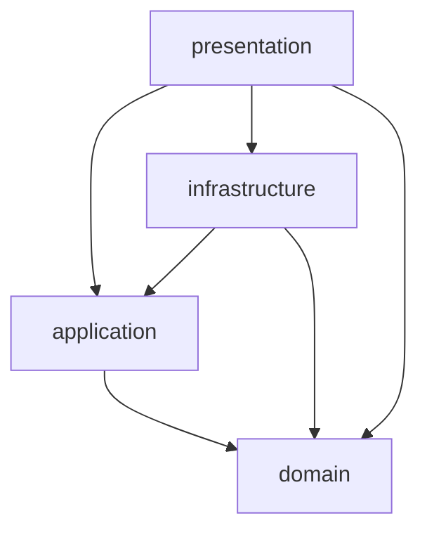

# 아키텍처

## 레이어
- 소스 코드는 `domain`, `application`, `infrastructure`, `presentation` 4개 레이어로 나눔
  - nocap의 변경은 대부분 바깥쪽에서 일어남. 예: 테스트 언어 추가, 실행 결과 입력, 출력 형식 추가, 명령 추가
  - 커버리지 판정 규칙은 거의 바뀌지 않음
  - 바뀌는 부분과 바뀌지 않는 부분을 나누면 입력 형식을 추가해도 판정 규칙을 고치지 않음
- `domain`은 커버리지 판정 규칙을 가짐
- (미구현) `application`은 유스케이스 흐름을 조립하고 포트 interface를 정의함
- (미구현) `infrastructure`는 포트를 구현함
- (미구현) `presentation`은 CLI와 출력 포매터를 가짐
- 라이브러리 진입점은 `presentation`에 속함

## 의존성 규칙
- 바깥 레이어는 안쪽 레이어를 import할 수 있음. 안쪽 레이어는 바깥 레이어를 import하지 않음
- 바깥 레이어는 중간 레이어를 건너뛰고 더 안쪽 레이어를 import할 수 있음
  - 포트와 포매터는 `domain` 타입을 직접 씀
  - 건너뛰기를 막으면 `domain` 타입과 같은 모양의 전달용 타입과 변환 코드가 필요함

## 디렉토리 규칙
- 레이어마다 `src/` 바로 아래에 레이어와 같은 이름의 디렉토리를 하나 둠
- `infrastructure`의 하위 디렉토리는 driven adapter 하나에 대응함
  - driven adapter는 `application`이 정의한 포트를 구현함. `application`은 포트를 통해 driven adapter를 호출함
  - driven adapter 하나는 입력 형식이나 외부 시스템 하나를 맡음
  - 입력 형식을 추가할 때 디렉토리 하나만 추가하면 됨
- `presentation`의 하위 디렉토리는 driving adapter 하나에 대응함
  - driving adapter는 사용자의 요청을 받아 `application`의 유스케이스를 호출함. 예: CLI, 라이브러리 API
- 여러 driving adapter가 함께 쓰는 코드는 특정 driving adapter의 디렉토리 밖에 둠
  - 예: 출력 포매터는 CLI와 라이브러리 API가 함께 씀. CLI 디렉토리 안에 두면 라이브러리 API가 CLI에 의존하게 됨
- 디렉토리는 그 안에 들어갈 코드를 만들 때 만듦

## 런타임
- nocap은 ESM 전용으로 배포함
  - Node 22.12부터 `require(esm)`이 기본으로 켜짐. CJS 사용자도 ESM 패키지를 불러올 수 있음
  - CJS와 ESM을 함께 빌드하면 빌드 설정과 배포 파일이 두 배가 됨
- nocap이 선언하는 Node 지원 범위는 테스트로 검증할 수 있는 범위와 같아야 함
  - 검증하지 않은 버전을 지원한다고 선언하면 사용자 환경에서 깨져도 미리 알 수 없음
- 최소 Node 버전을 올리는 변경은 major 버전 변경으로 다룸
  - 최소 버전을 올리면 기존 사용자 환경이 깨짐. 최소 버전을 낮추는 변경은 major 버전 변경이 아님
- Node 타입 정의의 major 버전은 최소 지원 Node의 major 버전과 같게 둠
  - 타입 정의가 더 높으면 지원하지 않는 Node API를 써도 타입 오류가 나지 않음
