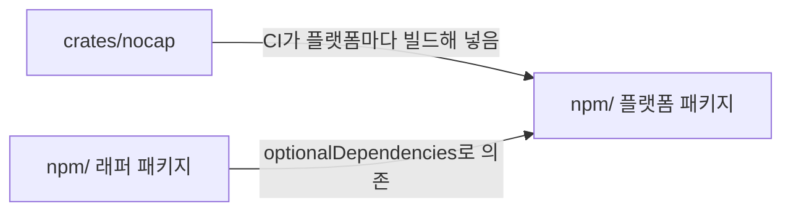

# 저장소 구조

## 루트
- 루트는 pnpm workspace의 루트임
- 루트는 Cargo workspace의 루트이기도 함. 두 workspace는 서로의 설정 파일을 읽지 않음
  - Cargo는 `Cargo.toml`이 있는 디렉토리만 crate로 봄. pnpm은 `package.json`이 있는 디렉토리만 패키지로 봄
- 루트는 배포하지 않음
- 루트에는 저장소 전체에 적용되는 것만 둠. 예: 포맷·린트 설정, CI, 릴리스 설정, `docs/`
  - 패키지마다 두면 패키지 사이에 규칙이 갈라짐

## 최상위 디렉토리
- 핵심 구현은 역할 이름의 디렉토리에 둠. 배포 생태계는 생태계 이름의 디렉토리에 둠
  - 핵심 구현은 하나임. 생태계 디렉토리는 핵심 구현을 그 생태계에 배포하는 포장임
  - 생태계는 빌드 도구와 배포 저장소로 나눔. 언어로 나누지 않음. 예: Java와 Kotlin은 `jvm/` 하나를 씀
- 최상위 디렉토리 하나는 관리 도구 하나에 대응함. 그 아래 디렉토리 하나가 패키지나 crate 하나임
  - 디렉토리 이름만 보고 어느 도구가 관리하는지 알 수 있음

| 디렉토리 | 담는 것 | 관리 도구 |
|---|---|---|
| `crates/` | Rust crate. 실행 파일을 만드는 crate도 포함함 | Cargo |
| `npm/` | npm에 배포하는 패키지 | pnpm |
| `jvm/` | (미구현) JVM 생태계에 배포하는 패키지 | Gradle |

- (미구현) Gradle 빌드의 루트는 `jvm/`임. 저장소 루트에 두지 않음
  - Gradle은 빌드 루트에 wrapper와 캐시 디렉토리를 만듦. 저장소 루트에 두면 루트에 세 도구의 파일이 섞임

## Rust
- (미구현) nocap의 핵심 구현은 Rust로 함
  - Rust는 실행 파일 하나로 배포함. Node가 없는 프로젝트에서도 nocap을 실행할 수 있음. 예: Kotlin, Java, Rust 프로젝트
- Rust 버전은 `rust-toolchain.toml`에 정확한 버전 하나로 고정함. 버전은 PR로 올림
  - 로컬과 CI가 같은 컴파일러와 clippy를 씀
  - 새 Rust 버전은 새 clippy lint를 더함. 버전을 고정하지 않으면 코드를 바꾸지 않아도 CI가 깨짐
- (미구현) npm 사용자는 `npm/`의 패키지로 Rust 실행 파일을 받음
  - CI가 플랫폼마다 실행 파일을 빌드해 `npm/`의 플랫폼 패키지에 넣음. 빌드 결과는 커밋하지 않음

## 패키지와 crate
- 패키지와 crate는 배포에 필요한 파일을 자기 디렉토리에 둠. 예: `LICENSE`, `CHANGELOG.md`
  - npm과 Cargo는 패키지나 crate 디렉토리 안의 파일만 배포 파일에 담음
- nocap을 소개하는 README는 루트에만 둠. `npm/nocap`은 pack 직전에 루트의 README를 자기 디렉토리로 복사함
  - GitHub는 루트의 README를 저장소 첫 화면에 보여 줌. npm은 패키지의 README를 패키지 페이지에 보여 줌
  - 두 곳에 README를 커밋하면 한쪽만 고쳐져 내용이 갈라짐
- 패키지와 crate는 빌드·테스트 설정을 자기 디렉토리에 둠. 예: `tsconfig.json`, `vitest.config.ts`
  - 패키지마다 의존성과 실행 환경이 다름

## 문서
- `docs/`에는 저장소 전체와 핵심 구현에 적용되는 문서를 둠. 예: 저장소 구조, 관리 절차
  - 핵심 구현의 문서는 crate 여러 개에 걸침. crate 하나의 디렉토리에 두면 crate 사이의 규칙을 둘 곳이 없음
  - 명세는 모든 생태계의 패키지가 내는 nocap의 동작을 정의함
- 생태계 디렉토리의 패키지에만 적용되는 문서는 그 패키지의 `docs/`에 둠. 예: `npm/nocap/docs/`
  - 패키지와 핵심 구현의 설계와 동작이 다를 수 있음. 루트에 두면 어느 쪽의 문서인지 알 수 없음
