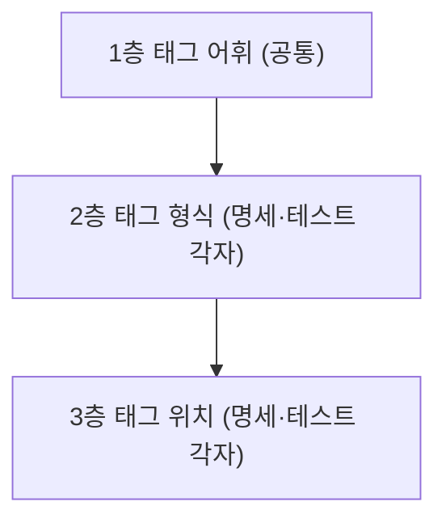

# nocap 문법

## 사용 예
```md
## 로그인 잠금
- 5회 연속 실패하면 계정을 잠금 <!--nocap:AUTH-001-->
- 잠금은 30분 후 풀림 <!-- nocap: AUTH-002 -->
- 이 항목에는 명세 태그가 없음
```

```ts
// nocap: AUTH-001
describe('5회 연속 실패하면 계정 잠금', () => {
  it('5번째 실패에서 계정을 잠근다', () => { /* ... */ })
})

describe('로그인', () => {
  // nocap: AUTH-001
  // nocap: AUTH-002
  it('잠긴 계정은 30분 뒤 다시 로그인할 수 있다', () => { /* ... */ })
})
```

- 둘째 `describe`의 `it()`은 머리 태그 2개를 쌓아 ID 2개를 가리킴

## 문법의 층
- nocap 문법은 3개 층으로 나뉨. 층은 규칙이 다루는 범위를 나눔
- nocap은 틀린 이유를 바깥 층부터 보고함. 순서는 [틀린 태그](#틀린-태그)가 정함



- 1층은 명세 태그와 테스트 태그가 같이 씀
  - 명세 태그와 테스트 태그는 같은 ID 문자열로 연결됨. 어휘가 다르면 한쪽에서 쓴 ID를 다른 쪽에서 쓸 수 없음
- 2층과 3층은 명세 태그와 테스트 태그가 따로 정함
  - 명세 태그는 명세 항목의 ID를 선언함. 테스트 태그는 명세 항목의 ID를 참조함
  - 역할이 다르면 담는 주석과 붙는 대상이 다름
- 한 항목이 가질 수 있는 태그 수는 3층이 정함
  - 꼬리 태그는 문장마다 1개만 붙음. 명세 항목 1개는 ID 1개를 가짐
  - 머리 태그는 테스트 호출 위에 여러 개 쌓임. 테스트 1개는 명세 항목 여러 개를 검증할 수 있음
- 새 규칙은 이 3개 층 중 한 층에 넣음. 한 규칙이 두 층에 걸치면 층별 규칙으로 나눔
  - 규칙의 층이 정해져야 틀린 태그의 이유를 층 단위로 보고할 수 있음

## 1층: 태그 어휘
- 태그: 본문이 `nocap:`으로 시작하는 주석. 명세 태그와 테스트 태그가 같은 접두어를 씀
- 접두어: 소문자 `nocap:`만 인식함. `nocap`과 `:` 사이에는 공백을 두지 않음
- ID 개수: 태그 하나에는 ID를 1개만 씀. 쉼표로 ID를 이어 쓰지 않음. 예: `nocap: AUTH-001`
- 공백: 주석 안쪽 앞뒤와 콜론 뒤의 공백은 있어도 되고 없어도 됨. 예: `<!--nocap:AUTH-001-->`
- ID 문자: 영문 대소문자, 숫자, `-`, `_`만 씀. 예: `AUTH-001`, `auth_1`
- 대소문자: ID는 대소문자를 구분함. 예: `AUTH-001`과 `auth-001`은 다른 ID임

## 2층: 태그 형식

### 명세 태그
- 명세 태그: 명세 문서의 `<!-- nocap: ID -->` 형식의 HTML 주석. 예: `<!-- nocap: AUTH-001 -->`
- 코드 안의 태그: 코드 블록과 인라인 코드 안의 태그는 명세 태그가 아님. 문서에서 태그 형식을 예시로 보일 때 씀

### 테스트 태그
- 테스트 태그: 테스트 코드의 `// nocap: ID` 라인 주석. 예: `// nocap: AUTH-001`
- 블록 주석: `/* nocap: ID */`와 `/** nocap: ID */`는 테스트 태그가 아님
- 블록 주석 안의 태그: nocap은 `nocap:`이 있는 블록 주석을 틀린 태그로 보고함. JSDoc 형식도 포함함. 예: 여러 줄 JSDoc 안의 ` * nocap: AUTH-001`
- 문자열 안의 태그: 문자열과 템플릿 리터럴 안의 `// nocap: ID`는 테스트 태그가 아님
- 테스트 파일 언어: 확장자로 정함. `.ts`, `.mts`, `.cts`, `.tsx`, `.js`, `.mjs`, `.cjs`, `.jsx`

## 3층: 태그 위치
- 명세 태그는 꼬리 태그임. 문장 끝에 붙인 태그 1개가 그 문장에 붙음
- 테스트 태그는 머리 태그임. 테스트 호출 위에 쌓은 태그가 모두 그 테스트 호출에 붙음
- nocap은 꼬리 태그를 트리 탐색으로 찾고, 머리 태그를 줄 탐색으로 찾음
  - Markdown에서 주석은 문서 트리의 노드임. 리스트 항목이 주석을 품으므로 주석 1개가 놓인 노드만 보고 붙을 문장을 정할 수 있음
  - TypeScript에서 주석은 구문 트리 밖에 있음. 테스트 호출이 주석을 품지 않으므로 줄의 이어짐으로만 주석과 테스트 호출을 연결할 수 있음

### 꼬리 태그
- 꼬리 태그 위치: 리스트 항목 첫 문단의 맨 끝. 예: `- 계정을 잠금 <!-- nocap: AUTH-001 -->`
- 트리 탐색: nocap은 명세 문서의 HTML 주석마다 Markdown 트리에서 놓인 곳을 아래 순서로 정함. 이 값을 배치라고 부름
  1. nocap은 주석을 품은 가장 가까운 리스트 항목을 찾음. 없으면 배치는 "리스트 항목 밖"임
  2. 주석이 그 리스트 항목의 첫 블록 전체이면 배치는 "첫 블록 전체"임
  3. 주석이 첫 문단의 마지막 노드이면 배치는 "첫 문단 끝"임
  4. 그 밖이면 배치는 "리스트 항목 안의 다른 곳"임
- 배치가 첫 문단 끝인 태그만 꼬리 태그임. 다른 배치의 태그는 틀린 태그임

```md
- 계정을 잠금 <!-- nocap: AUTH-001 -->
- <!-- nocap: AUTH-002 --> 문장이 뒤에 있음
- <!-- nocap: AUTH-003 -->
- 첫 문단

  둘째 문단 <!-- nocap: AUTH-004 -->

## 잠금 <!-- nocap: AUTH-005 -->
```

| 태그 | 배치 | 결과 |
|---|---|---|
| `AUTH-001` | 첫 문단 끝 | 꼬리 태그 |
| `AUTH-002` | 리스트 항목 안의 다른 곳 | 틀린 태그: 리스트 항목 끝이 아님 |
| `AUTH-003` | 첫 블록 전체 | 틀린 태그: 명세 문장 없음 |
| `AUTH-004` | 리스트 항목 안의 다른 곳 | 틀린 태그: 리스트 항목 끝이 아님 |
| `AUTH-005` | 리스트 항목 밖 | 틀린 태그: 리스트 항목 밖 |

- 태그 수: 문장마다 꼬리 태그는 1개임. 첫 문단의 마지막 노드는 1개뿐이기 때문임. 예: `- 문장 <!-- nocap: A --> <!-- nocap: B -->`에서 `A`의 배치는 리스트 항목 안의 다른 곳임
- 태그만 있는 항목: 문장 없이 태그만 있는 리스트 항목은 명세 항목이 아님. 태그 앞에 명세 문장을 씀

### 머리 태그
- 머리 태그 위치: 테스트 호출 바로 위의 주석 덩어리 안
- 주석 줄: 주석만 있는 줄. 주석 앞이나 뒤에 같은 줄의 코드가 있으면 주석 줄이 아님. 예: `foo() // nocap: AUTH-001`
- 줄 탐색: nocap은 테스트 호출마다 아래 순서로 주석을 모음. 모은 주석들을 주석 덩어리라고 부름
  1. nocap은 테스트 호출이 시작하는 줄의 바로 윗줄을 봄
  2. 그 줄이 주석 줄이면 그 주석을 덩어리에 넣음. 그 주석이 시작하는 줄의 바로 윗줄로 올라가 2단계를 반복함
  3. 주석 줄이 아니면 멈춤. 빈 줄과 코드가 있는 줄이 여기 해당함
- 주석 덩어리는 라인 주석과 블록 주석을 모두 포함함
- 덩어리 안의 테스트 태그는 모두 그 테스트 호출에 붙음. 다른 주석은 건너뜀
- 어떤 덩어리에도 들지 않은 태그는 틀린 태그임

```ts
// nocap: AUTH-001
// @ts-expect-error 잘못된 입력을 일부러 넘김
it('잠긴 계정을 거부한다', () => {})

// nocap: AUTH-002

it('다른 테스트', () => {})
foo() // nocap: AUTH-003
```

| 주석 | 줄 탐색 | 결과 |
|---|---|---|
| `// nocap: AUTH-001` | 첫 `it()`의 주석 덩어리에 듦 | 머리 태그 |
| `// @ts-expect-error` | 같은 주석 덩어리에 듦 | 건너뜀 |
| `// nocap: AUTH-002` | 아래가 빈 줄이라 어떤 덩어리에도 들지 않음 | 틀린 태그: 테스트 호출 위가 아님 |
| `// nocap: AUTH-003` | 코드가 있는 줄이라 주석 줄이 아님 | 틀린 태그: 코드 뒤의 주석 |

- 테스트 호출: TypeScript와 JavaScript 테스트 파일에서 머리 태그가 붙는 대상. `it`, `test`, `describe`, `suite` 호출이고, 수식자가 붙은 호출도 포함함. 예: `it.skip()`, `test.each([...])()`
- 같은 ID: 주석 덩어리 안에 같은 ID의 태그가 2개 이상이면 첫 태그만 테스트 태그임. 뒤의 태그는 틀린 태그임

## 틀린 태그
- nocap은 `nocap:`으로 시작하지만 명세 태그나 테스트 태그가 되지 못한 주석을 모두 틀린 태그로 보고함
- nocap은 틀린 태그로 명세 항목이나 테스트 항목을 만들지 않음
- nocap은 주석 덩어리의 나머지 테스트 태그로 테스트 항목을 만듦. 예: `// nocap: A-001` 아래에 `// nocap: A.2`가 있으면 테스트 항목의 ID는 `A-001`임
- nocap은 틀린 태그 1개에 틀린 이유를 1개만 보고함
- 이유가 여러 개이면 위치 위반, 블록 주석, ID 누락, ID 개수 초과, ID 규칙 위반, 같은 ID 반복 순서로 앞의 것을 보고함
  - 3층, 2층, 1층 순서임. 같은 ID 반복만 맨 뒤에 둠. 이 검사는 ID가 올바른 태그끼리만 비교할 수 있음

| 층 | 틀린 이유 | 예 |
|---|---|---|
| 1층 | ID 누락 | `// nocap:` |
| 1층 | ID 개수 초과 | `<!-- nocap: AUTH-001, AUTH-002 -->`, `// nocap: AUTH-001, AUTH-002`, `// nocap: AUTH-001,,AUTH-002` |
| 1층 | ID 규칙 위반 | `<!-- nocap: AUTH.1 -->`, `// nocap: AUTH-001 AUTH-002`, `// nocap: AUTH-001,` |
| 2층 | 블록 주석 | `/* nocap: AUTH-001 */`, `/** nocap: AUTH-001 */` |
| 3층 | 명세 문장 없음 | `- <!-- nocap: AUTH-001 -->` |
| 3층 | 리스트 항목 끝이 아님 | `- <!-- nocap: AUTH-001 --> 계정을 잠금` |
| 3층 | 리스트 항목 밖 | `## 잠금 <!-- nocap: AUTH-001 -->` |
| 3층 | 코드 뒤의 주석 | `foo() // nocap: AUTH-001` |
| 3층 | 테스트 호출 위가 아님 | 빈 줄 위의 `// nocap: AUTH-001`, `wrap(it())` 위의 `// nocap: AUTH-001` |
| 3층 | 같은 ID 반복 | 주석 덩어리 안의 둘째 `// nocap: AUTH-001` |

- ID 개수 초과: `nocap:` 뒤를 쉼표로 나눈 값 중 빈 값이 아닌 것이 2개 이상임
- nocap은 `nocap:`으로 시작하지 않는 주석을 태그로 보지 않고 보고하지 않음. 예: `// TODO`, `// @ts-expect-error`, `// NOCAP: AUTH-001`, `// nocap : AUTH-001`
- 출력 형식과 진단 종류의 이름은 [CLI](specs/cli.md)가 정함

## 설명
- 태그는 ID 앞의 기호 대신 도구 이름 접두어 `nocap:`으로 표시함
  - `@`는 JSDoc과 TypeScript 지시문이 이미 씀. 예: 테스트 호출 바로 위의 `// @ts-expect-error`가 테스트 태그로 읽혔음
  - 도구 이름 접두어는 다른 도구의 관례와 겹치지 않음. 예: `eslint-disable`, `prettier-ignore`
  - 접두어로 시작하는 주석은 태그를 쓰려 한 주석임이 확실함. 그래서 nocap은 틀린 태그를 오탐 없이 보고함
- 접두어는 소문자 `nocap:`만 인식함
  - 표기가 하나이면 `grep "nocap:"`으로 모든 태그를 찾음
- 콜론 앞에는 공백을 허용하지 않음
  - nocap은 `nocap:`을 한 덩어리 표지로 다룸. 그래서 태그인지 판단하는 기준은 "글자 그대로 `nocap:`으로 시작함" 하나임
- 태그 하나에는 ID를 1개만 씀. 여러 ID는 테스트 태그 줄을 쌓아서 씀
  - 2026-11-05에 이 저장소의 테스트 태그 103개 중 ID가 2개 이상인 태그는 2개였음. 쉼표 문법은 2%의 태그를 위해 모든 태그가 지는 비용이었음
  - ID 1개가 줄 1개에 대응하면 nocap은 틀린 ID나 알 수 없는 ID의 줄을 정확히 보고함
  - 쉼표를 쓴 태그는 ID 규칙 위반 대신 ID 개수 초과로 보고함. 사용자가 ID 여러 개를 쓰려 한 것이 분명하고, 고치는 방법이 "줄을 나눔" 하나이기 때문임
- 테스트 태그는 `//` 라인 주석만 씀
  - 블록 주석은 코드와 같은 줄에 올 수 있음. 예: `/* nocap: A */ it()`. 라인 주석은 항상 줄 끝까지 가서 이런 경우가 생기지 않음
  - JSDoc의 `*`를 다루려면 1층 어휘가 주석 종류마다 달라짐
- 주석 덩어리 안의 다른 주석은 건너뜀
  - `@ts-expect-error`, `eslint-disable-next-line`, `prettier-ignore`는 바로 다음 줄에만 적용됨. 그래서 이 지시문은 테스트 호출 바로 위에 있어야 하고, 테스트 태그는 그 위에 올 수밖에 없음
  - 블록 주석도 건너뜀. 주석 기호가 `//`인지 `/** */`인지에 따라 태그가 붙는지가 달라지면 안 됨
- 빈 줄은 주석 덩어리를 끊음
  - 빈 줄을 건너뛰면 지운 테스트의 태그가 다음 테스트에 조용히 붙음. 그러면 검증하지 않은 명세 항목이 커버됨으로 판정됨
  - 커버되지 않은 명세는 nocap이 보고함. 잘못 커버된 명세는 아무도 모름
- 주석 덩어리 안의 같은 ID는 틀린 태그로 보고함
  - 같은 줄이 두 번 생기는 경로는 대개 윗줄을 복사하고 ID를 고치지 않은 경우임. 보고하지 않으면 사용자는 고치려던 ID가 커버되지 않은 이유를 모름
- 틀린 테스트 태그가 있어도 주석 덩어리의 나머지 태그로 테스트 항목을 만듦
  - 테스트 항목을 버리면 오타 1개가 "커버되지 않음" 보고를 추가로 만듦. 그 보고는 거짓임
  - 틀린 태그는 보고되므로 nocap 실행은 실패함. 그래서 일부만 성공한 상태가 조용히 통과하지 않음
- 위치가 틀린 태그도 보고함
  - 위치가 틀린 태그를 버리면 사용자는 "커버되지 않음"만 봄. 원인이 태그 위치라는 단서가 없음
  - 위치 위반을 형식 위반보다 먼저 보고함. 위치가 틀린 태그는 형식을 고쳐도 어떤 항목에도 붙지 않음
- JSDoc 형식의 블록 주석도 보고함
  - `/** nocap: A */`의 본문은 `*`로 시작해서 1층 기준으로는 태그가 아님. 하지만 사용자가 JSDoc에 익숙해서 실제로 쓸 만한 실수임
  - 보고할 때만 `*`를 지움. 태그로 받아들이지 않으므로 1층 어휘는 바뀌지 않음
- ID는 대소문자를 구분함
  - 구분하지 않으면 `grep "nocap: AUTH-001"`이 `auth-001`을 찾지 못함
- ID 첫 글자는 제한하지 않음
  - `AUTH-`처럼 번호를 빠뜨린 ID는 커버리지 판정이 이미 "알 수 없는 ID"나 "커버되지 않은 명세"로 보고함
